<div align="center">

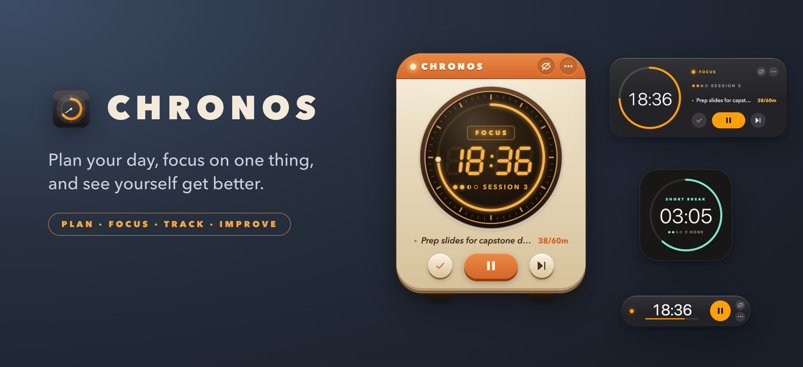

# Chronos

### A little retro-futuristic clock that lives on your desktop, plans your day with you, helps you focus, gets out of the way when you need it to, and quietly learns how you work.


[**Tour**](#%EF%B8%8F-watch-the-tour) · [**Features**](#-what-it-does) · [**Get better**](#-how-chronos-helps-you-get-better) · [**Planner**](#%EF%B8%8F-plan-your-day) · [**Claude Code**](#-to-dos-from-claude-code) · [**Widgets**](#%EF%B8%8F-pick-your-clock) · [**Insights**](#-is-my-focus-getting-better) · [**Shortcuts**](#%EF%B8%8F-keyboard-shortcuts) · [**Install**](#-install) · [**How it's built**](#%EF%B8%8F-how-its-built)

</div>

---

## ▶️ Watch the tour

<a href="docs/chronos-tour.mp4">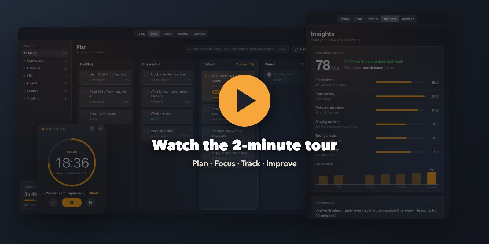</a>

**Two minutes, narrated:** planning the day, capturing a task from any app, focusing on one live task, and how Chronos turns your sessions into a weekly score and insights. [Open the video](docs/chronos-tour.mp4) (MP4, 1080p, with subtitles burned in so it works on mute).

---

## 💡 Why Chronos?

Most Pomodoro apps are either a bare countdown or yet another dashboard fighting for your attention. Chronos is different:

> **The productivity app should never become another distraction.**

- 🕰️ **It's an object, not an app.** A small desk clock with a glowing 7-segment display, a ticking dial and real buttons. It sits on top of your work without shouting.
- 🫥 **It disappears when you need it to.** Press <kbd>⌘</kbd><kbd>⇧</kbd><kbd>H</kbd>, or let it hide by itself when you start screen sharing. The timer keeps running.
- 🗂️ **It knows what you're working on.** Plan Today, This week and a Backlog, and the top task goes live on the clock, with time spent against your estimate.
- 📈 **It answers one question:** *"Am I actually getting better at focusing?"* It gives you a weekly score, honest stats, and insights drawn from **your** data.
- 🔒 **Private by default.** No account, no cloud, no tracking. Everything lives in one file on your Mac.

---

## ✨ What it does

<table>
<tr>
<td width="50%" valign="top">

### ⏱️ A timer you can bend
- Focus, short and long breaks, with a long break every *N* sessions
- Modes: **Standard 25/5**, **Deep Work 50/10**, **Quick 15/5**, or your own
- Change time **without restarting**: <kbd>+5</kbd> <kbd>+10</kbd> <kbd>−5</kbd>, scroll the dial, or click the digits and type `18:42`
- Rock-solid timing: it runs on absolute end times in Rust, so sleep, hidden windows and app crashes can't make it drift

</td>
<td width="50%" valign="top">

### 🫥 Stays out of the way
- **Hide mode** from a hotkey, the menu bar or a button
- **Auto-hide** while Zoom screen sharing, the ⌘⇧5 recorder, OBS (or apps you add) are running
- Optional **invisible-to-screenshots** mode
- **Do Not Disturb** turns on during focus and off on breaks
- An optional countdown in the **menu bar**

</td>
</tr>
<tr>
<td width="50%" valign="top">

### 🧭 Honest focus data
- **Away detection:** step away for 5 minutes and the session pauses *back-dated to when you left*, so away time never counts
- **Distraction log:** <kbd>⌃</kbd><kbd>⌥</kbd><kbd>D</kbd> from any app, with an optional reason
- **Reflection** after each session: 😫 😐 🙂 🔥
- **Projects:** type `Finish resume #job-search` and see where your hours go

</td>
<td width="50%" valign="top">

### 🧠 It learns how you work
- A **weekly score out of 100** with a transparent breakdown
- **Insights** that only appear when the data backs them up
- **One suggestion at a time**, e.g. *"Ready to try 30-minute sessions?"*, applied in one click and never repeated once you say no
- A **weekly email** summary (opt-in, through your own Gmail)

</td>
</tr>
<tr>
<td width="50%" valign="top">

### 🗂️ A planner that feeds the clock
- **Backlog · This week · Today · Done**, in the panel or widened into a **board** you drag cards across
- The **top Today task goes live** when focus starts; press <kbd>D</kbd> when it's done and the next one moves in, without stopping the timer
- **Estimates vs actual**: cards and the clock show `38/60m`, and Today shows how your plan compares with your daily goal
- A **morning prompt** once a day: pick what goes in Today

</td>
<td width="50%" valign="top">

### ⚡ Capture from anywhere
- <kbd>⌃</kbd><kbd>⌥</kbd><kbd>T</kbd> opens a small box over any app
- Type naturally: `Prep slides 28min #job-search` becomes a title, a project and an estimate
- <kbd>Enter</kbd> adds it to Today, <kbd>Tab</kbd> picks another list, <kbd>⌘</kbd><kbd>Enter</kbd> adds it **and starts focus**

</td>
</tr>
<tr>
<td width="50%" valign="top">

### 🤖 To-dos from Claude Code
- When Claude Code needs **you** to do something (log in, add a key, test on a device), it puts a to-do at the **top of Today**
- Tagged with the project it's working in, with the exact command or link in a note
- Set up once and it works in **every project**, even while Chronos is closed

</td>
<td width="50%" valign="top">

### 🔒 Private by default
- No account, no cloud, no telemetry
- Everything lives in **one SQLite file** on your Mac
- The only thing that ever leaves is the weekly email, and only if you turn it on

</td>
</tr>
</table>

---

## 📈 How Chronos helps you get better

Chronos runs one loop, every day. Each step produces a little honest data, and the next step uses it.

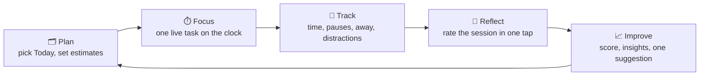

| Step | What you do | What Chronos records | How it's used |
|---|---|---|---|
| 🗂️ **Plan** | Pick what goes in Today each morning, with rough estimates | Tasks, projects, estimates | *Today's load* warns you before you over-plan your day |
| ⏱️ **Focus** | Press start; the top task goes live | Focus time credited to that task, `spent/estimate` | Shows where your hours really went, by task and by `#project` |
| 🧭 **Track** | Nothing. It happens on its own, plus <kbd>⌃</kbd><kbd>⌥</kbd><kbd>D</kbd> when something pulls you away | Pauses, away time (back-dated), distractions and their reasons | *Staying on task*, distraction peaks, your top distraction |
| 🙂 **Reflect** | Tap 😫 😐 🙂 🔥 after a session (optional) | How productive each session felt | *Session quality*, and which session lengths work best for you |
| 📈 **Improve** | Read your weekly score; accept or skip one suggestion | Week-over-week trends | Your best start window, your strongest weekday, the minute you tend to give up, and a nudge like *"Ready to try 30-minute sessions?"* |

> 🧪 **No guesswork.** Every number shows the evidence behind it. An insight only appears when there's enough data to back it up, and missing data is never counted as zero.

---

## 🎛️ Pick your clock

Four sizes, three styles. Switch any time from the clock's <kbd>⋯</kbd> menu or in Settings, and drag the corner to resize.

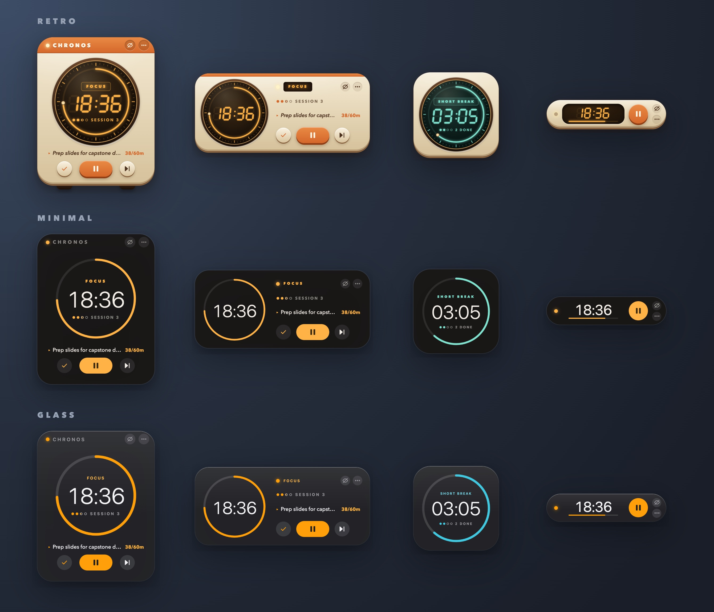

| | Widget | What you see | Best for |
|:-:|---|---|---|
| 🟧 | **Large** | The full desk clock: dial, task, keys | The full experience |
| ▬ | **Medium** | Dial plus phase, session, task and keys | Wide screens, a side-of-display widget |
| ◼️ | **Small** | Just the dial (keys appear on hover) | A tidy corner companion |
| 💊 | **Pill** | Time, a progress line, one key | Maximum focus, minimum distraction |

> 🎨 **Retro** is warm putty plastic with an amber CRT glow. **Minimal** is flat and quiet, and follows your Mac's light or dark mode. **Glass** is Apple-style frosted grey with orange only where it matters, also following light or dark. Each phase has its own colour: **amber/orange** for focus, **teal** for short breaks, **violet** for long breaks.

---

## 🗂️ Plan your day

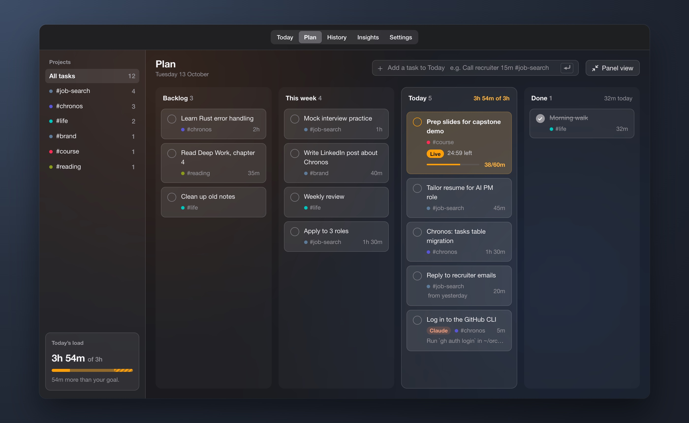

The **Plan** tab holds four lists: **Backlog**, **This week**, **Today** and **Done**.

- **Panel or board.** In the panel you see one list at a time. Press **Board view** (or <kbd>⌘</kbd><kbd>E</kbd>) and the same window widens into four columns you can drag cards across, with a project filter and *Today's load*. Switch to another tab and it shrinks back.
- **Type it the way you think.** `Email campaign 2hr 15min #work` → *Email campaign*, `#work`, 2h 15m. A number inside the title stays in the title (`Read 3 chapters`), and a task with no estimate is never counted as zero.
- **One live task.** When focus starts, the top Today task goes live: the clock shows it with `spent/estimate`, and the time you focus is credited to it. Pauses and away time never count. Switch tasks mid-block and the time is split between them.
- **Finish, then flow.** <kbd>D</kbd> on the clock (or the tick on a card) marks it done with a `✓ Prep slides · 38m` flash, and the next task goes live. <kbd>N</kbd> sends the live task to the bottom of Today. <kbd>S</kbd> still means *skip to break*.
- **See what you finished.** The Done column totals the time you put into today's finished tasks.
- **Honest plans.** Today compares *focus already done + what's left of each estimate* with your daily goal: *"3h 49m planned · goal 3h · 49m over."*
- **Good morning.** The first time you're at your Mac each day (after 5 AM, not while screen sharing), Plan opens with a sheet: yesterday's leftovers ticked, This week and the backlog on offer. **Start the day** makes Today exactly what you picked; the rest goes back to This week.
- **Two looks.** The panel, board and pop-ups use **Glass** by default (frosted, neutral, orange only as an accent) or **Retro** (cream and orange), chosen in *Settings → Look*.

---

## 🤖 To-dos from Claude Code

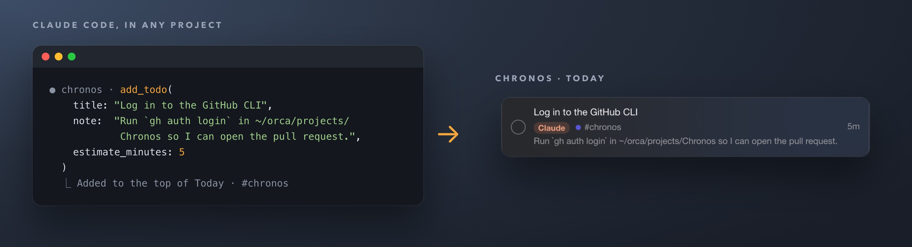

When Claude Code hits something only you can do, like logging in, pasting a secret, approving a payment or testing on your phone, it doesn't just mention it in a chat you might scroll past. It adds a to-do to Chronos, right at the top of Today, where your next focus session will find it.

- **Tagged and explained.** Each to-do is tagged `#<project folder>` and carries a note with the exact command, file or link. Hover a card to read the whole note.
- **Claude only touches its own.** Claude can add, list and tick off the to-dos it created. It never sees or changes the tasks you write. Ask it twice and it won't add a duplicate.
- **Works with Chronos closed.** `chronos mcp` is a small MCP server built into the app. It writes to the same local database, and a running Chronos shows new to-dos within about two seconds.
- **Ordinary tasks after that.** A **Claude** badge marks them in the Plan tab and on the board; otherwise you can drag, edit, start or delete them like any other task.

Set it up once for every project:

```bash
claude mcp add --scope user chronos -- /Applications/Chronos.app/Contents/MacOS/chronos mcp
```

Then tell Claude when to use it in `~/.claude/CLAUDE.md`. The full instructions, the three tools (`add_todo`, `list_todos`, `complete_todo`) and how to turn it off are in **[docs/CLAUDE-CODE.md](docs/CLAUDE-CODE.md)**.

---

## 📊 Is my focus getting better?

Chronos has five tabs: **Today**, **Plan**, **History**, **Insights** and **Settings**.

- **Today**: focus against your daily goal, the live session, a timeline of every session and distraction, and hours by project.
- **History**: any week or month next to the one before it: focus per day, *when* you focus and get distracted, projects and distraction reasons.
- **Insights**: the weekly score with its evidence, the last 8 weeks, one suggestion, and what your data says.
- **Settings**: five short sections (*Timer · Focus · Look · Hiding · General*), one line per option, with an ⓘ hint wherever an option needs explaining.

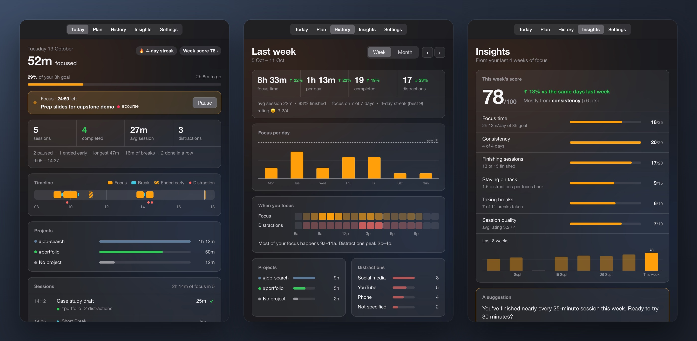

<details>
<summary><b>🧮 How the weekly score works</b> (click to expand)</summary>

<br>

The score is out of 100 and made of six parts. Each part shows the evidence behind it, so you always know *why* it moved.

| Part | Points | Full marks when… |
|---|:-:|---|
| ⏳ Focus time | 25 | your daily average reaches your daily goal |
| 📅 Consistency | 20 | you finish a session every day |
| ✅ Finishing sessions | 20 | you complete what you start |
| 🎯 Staying on task | 15 | you log 0 distractions per focus hour (4 or more per hour = 0 points) |
| ☕ Taking breaks | 10 | you take a real break after each session |
| 🔥 Session quality | 10 | you rate your sessions "Great" |

- If a part has no data yet (say you never rate sessions), it's **left out and the rest is rescaled** to 100. Missing data is never counted as zero.
- The score is compared with **the same days of last week**, so a Thursday is never judged against a full week.
- Chronos also tells you which part moved the score most, e.g. *"Mostly from consistency (+6 pts)"*.

</details>

<details>
<summary><b>🔍 What kind of insights?</b></summary>

<br>

Every insight comes from the last four weeks of *your* sessions, and shows what it's based on. If there isn't enough data, Chronos stays quiet.

| Insight | Example | Shown only when… |
|---|---|---|
| Best start window | *"You finish 27% more of your sessions when you start between 9 AM and 12 PM."* | at least 5 sessions inside and outside the window, and a gap of 15 points or more |
| Where you give up | *"When you stop a session early, it's usually around minute 38."* | at least 4 sessions ended early |
| Distraction peak | *"Your distractions peak between 2 PM and 4 PM."* | at least 6 distractions, 30% or more of them in that window |
| Top distraction | *"YouTube is behind 45% of your distractions."* | at least 5 distractions with a reason |
| Session length trend | *"Your average session grew from 31 to 42 minutes."* | at least 5 sessions in each 2-week half, and a change of 15% or more |
| Strongest weekday | *"Tuesdays are your strongest days, averaging 2h 10m of focus."* | at least 8 active days |
| Quality vs length | *"You rate sessions of 30 minutes or less as more productive."* | at least 4 rated sessions of each kind |

</details>

<details>
<summary><b>💬 Suggestions and the companion</b></summary>

<br>

**One suggestion at a time**, with a one-click button. Once you accept or decline one, it never comes back.

- *"You've finished nearly every 25-minute session this week. Ready to try 30 minutes?"*
- *"You finish fewer 50-minute sessions than you start. Try 30-minute sessions for a while?"*
- *"Distractions are up 30% this week. Turn on Do Not Disturb during focus sessions?"*
- *"You've been skipping most of your breaks. Want breaks to start on their own?"*

**Companion lines** appear on the clock after a session ends, and **at most one every 90 minutes**:

> *"Daily goal hit: 3h. Nice work."* · *"2h 15m of focus. Take a real break."* · *"Pushing hard. A break might help."*

</details>

<details>
<summary><b>📬 The weekly email</b></summary>

<br>

Opt in under **Settings → General → Weekly email**. Every Monday at 9 AM (or whenever you choose), you get last week's score, your numbers vs the week before, focus per day, projects, top insights and one thing to try. **Task names are never included.**

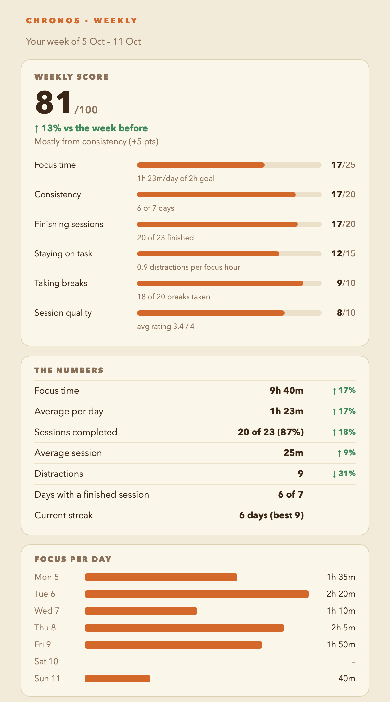

It's sent through **your own Gmail** using an [app password](https://myaccount.google.com/apppasswords), which is stored only in the **macOS Keychain**. If your Mac is asleep at send time, the email goes out at the next chance.

</details>

### Tiny popups, never in the way

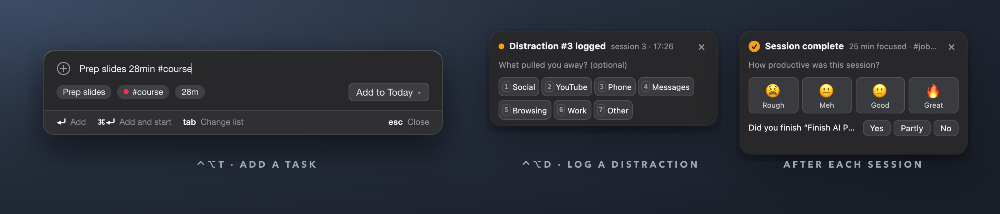

The distraction and reflection popups close themselves, never need an answer, and stay hidden while you're sharing your screen. The add-task box opens only when you press <kbd>⌃</kbd><kbd>⌥</kbd><kbd>T</kbd>.

---

## 🔄 A session, end to end

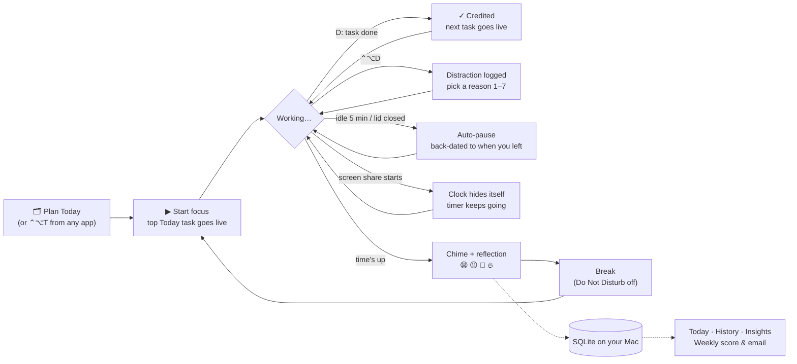

---

## ⌨️ Keyboard shortcuts

| Anywhere on your Mac | |
|---|---|
| <kbd>⌘</kbd> <kbd>⇧</kbd> <kbd>H</kbd> | Hide or show the clock (the timer keeps running) |
| <kbd>⌃</kbd> <kbd>⌥</kbd> <kbd>D</kbd> | Log a distraction |
| <kbd>⌃</kbd> <kbd>⌥</kbd> <kbd>T</kbd> | Add a task (<kbd>⌘</kbd><kbd>Enter</kbd> adds it and starts focus) |

| With the clock focused | |
|---|---|
| <kbd>Space</kbd> | Start, pause or resume |
| <kbd>R</kbd> / <kbd>⇧</kbd> <kbd>R</kbd> | Reset / restart the session |
| <kbd>S</kbd> | Skip to the next phase |
| <kbd>↑</kbd> <kbd>↓</kbd> | ±1 minute (add <kbd>⇧</kbd> for ±5) |
| <kbd>Enter</kbd> | Type an exact time: `25`, `18:42`, `1h 15m` |
| <kbd>T</kbd> | Set what you're working on (add `#project`); it matches a Today task or adds one at the top |
| <kbd>D</kbd> | Done with the live task; the next one goes live |
| <kbd>N</kbd> | Next task: the live one moves to the bottom of Today |
| <kbd>⌘</kbd> <kbd>,</kbd> | Open Settings |
| Right-click or <kbd>⋯</kbd> | Menu: modes, widget size, style, always on top, stats |

| In the Plan tab | |
|---|---|
| <kbd>⌘</kbd> <kbd>E</kbd> | Switch between the panel and the board |
| <kbd>Enter</kbd> / <kbd>Tab</kbd> / <kbd>Esc</kbd> | In the add box: add, change list, clear |
| <kbd>↑</kbd> <kbd>↓</kbd> | Move between tasks |
| <kbd>⌥</kbd> <kbd>↑</kbd> <kbd>↓</kbd> | Move a task up or down its list |
| <kbd>⌥</kbd> <kbd>←</kbd> <kbd>→</kbd> | Move a task to the neighbouring list |
| <kbd>Space</kbd> / <kbd>Enter</kbd> / <kbd>⌫</kbd> | Done / edit / delete (with Undo) |

All three global shortcuts can be changed in Settings.

---

## 📦 Install

Chronos is built from source for now. It takes about 5 minutes the first time.

```bash
# 1. Prerequisites: Node 20+, Rust, and Xcode Command Line Tools
curl --proto '=https' --tlsv1.2 -sSf https://sh.rustup.rs | sh
xcode-select --install

# 2. Build
git clone https://github.com/nikharjajoo-tech/chronos.git
cd chronos
npm install
npm run tauri build -- --bundles app

# 3. Install and launch
cp -R src-tauri/target/release/bundle/macos/Chronos.app /Applications/
open -a Chronos
```

**Then:**
- Look for the 🕰️ **alarm-clock icon in your menu bar**. The clock appears in the top-right corner.
- **Open at login** is on by default, so Chronos comes back after a restart.
- Find it any time in **Launchpad** or **Spotlight**. Opening it again brings a hidden clock back.

<details>
<summary><b>🛠️ Developing</b></summary>

<br>

```bash
npm run tauri dev   # the real app with hot reload
npm run dev         # just the UI in a browser, with a mock backend
npm test            # frontend tests (Vitest)
npm run test:rust   # Rust tests: timer, database, analytics, insights, email…
```

The browser preview takes URL parameters for any state, which makes design work quick:
`http://localhost:1420/?view=clock&widget=pill&style=minimal&phase=focus&run=running&remaining=1122`

Planner states work the same way: `?view=panel&board&live&run=running#plan` (the board with a live task), `?view=panel&morning#plan` (the morning sheet), `?view=quick&quick=add` (the ⌃⌥T box), `?theme=retro`, and `?tasks=0` for empty lists.

</details>

---

## 🔒 Privacy

| | |
|---|---|
| 📁 **Where your data lives** | `~/Library/Application Support/com.chronos.desk/chronos.sqlite3`, one file you can open, back up or delete |
| ☁️ **Network access** | **None**, except the weekly email if you turn it on (sent through your own Gmail) |
| 🤖 **Claude Code** | Optional. The `chronos mcp` server runs locally and only reads or changes the to-dos Claude added, never your own tasks. |
| 👤 **Accounts and telemetry** | None |
| 🔑 **Passwords** | Only the optional Gmail app password, kept in the macOS Keychain |
| 🙈 **Screen-sharing safety** | Auto-hide, a hide hotkey, and capture protection. The morning prompt waits until sharing stops. |
| 🗂️ **Your tasks** | Stored in the same local file. Task names never go into the weekly email. |

---

## 🏗️ How it's built

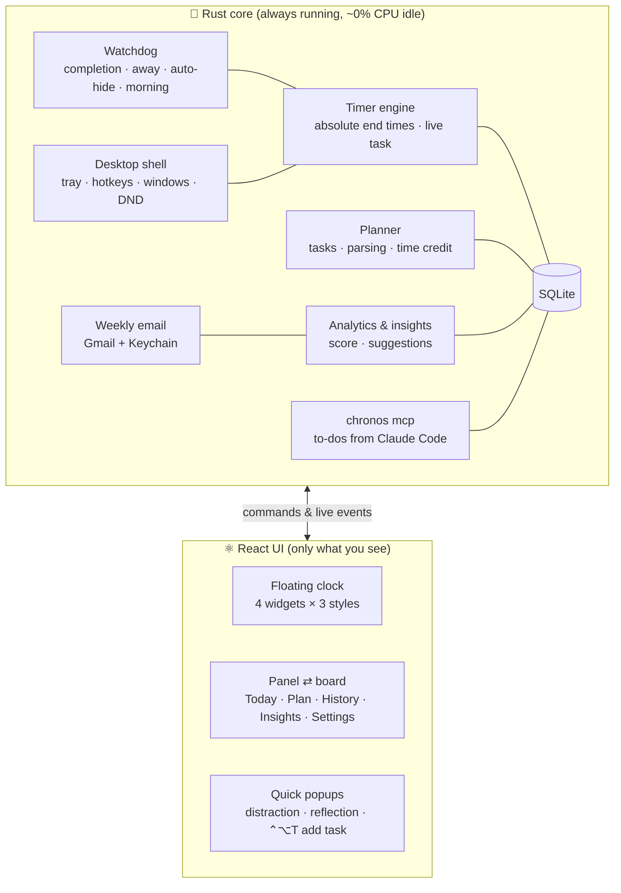

| Piece | Choice | Why this over the alternatives |
|---|---|---|
| App shell | **Tauri 2** | Uses the browser engine built into macOS instead of shipping Chrome the way Electron does, so the app is about **5 MB** and uses about **30 MB of memory** |
| Brain | **Rust** | Fast, battery-friendly and hard to crash. It keeps the timer accurate even when the window is hidden. |
| Interface | **React + TypeScript** | Quick to build and change. TypeScript catches mistakes early. |
| Storage | **SQLite** | One local file, no server, good at "this week vs last week" queries |
| Styling | **Hand-written CSS** | The clock is a custom object, not a standard dashboard |
| Secrets | **macOS Keychain** | The same safe storage Safari uses for passwords |

<details>
<summary><b>📁 Project structure</b></summary>

```text
chronos/
├── src/                      # React UI
│   ├── clock/                # floating clock: layouts, dial, 7-segment digits
│   ├── panel/                # Today · Plan (panel + board) · History · Insights · Settings
│   ├── quick/                # distraction & reflection popups, ⌃⌥T add-task box
│   └── api.ts                # the one doorway to Rust (plus a browser mock)
├── src-tauri/src/            # Rust core
│   ├── timer.rs              # pure Pomodoro state machine (no clocks, no I/O)
│   ├── engine.rs             # timer + settings + database glue, live task, morning prompt
│   ├── tasks.rs              # planner types and the task parser
│   ├── db.rs                 # SQLite schema & migrations
│   ├── mcp.rs                # `chronos mcp`: MCP server so Claude Code can add to-dos
│   ├── analytics.rs          # weekly / monthly aggregates, streaks
│   ├── insights.rs           # score, insights, suggestions, companion lines
│   ├── companion.rs          # watchdog, away detection, auto-hide, DND, popups
│   ├── report.rs             # weekly email: render, schedule, send
│   ├── sysmac.rs             # macOS idle time, process list, Shortcuts
│   └── shell.rs              # windows, tray, menus, global hotkeys
├── docs/DESIGN.md            # the design notes behind all of this
├── docs/PLANNER-PHASE1.md    # the planner's spec
├── docs/CLAUDE-CODE.md       # setting up Claude Code to-dos
└── docs/chronos-tour.mp4     # the 2-minute narrated tour
```

</details>

**Tested:** 99 Rust tests (timer maths, sleep and crash recovery, away pauses, analytics, score, insights, suggestions, email rendering, task parsing, live-task time credit, the morning prompt) and 36 UI tests (formatting, drag-and-drop maths, planned load).

---

## 🗺️ Roadmap

- [x] Floating clock: 4 widgets × 3 styles, hide mode, always on top
- [x] Drift-proof timer with crash recovery
- [x] Away detection, auto-hide while sharing, Do Not Disturb
- [x] Distractions, reflections, projects
- [x] History, weekly score, insights, suggestions
- [x] Weekly email
- [x] Planner: Today / This week / Backlog, board view, live task, estimates vs actual, ⌃⌥T quick add, morning prompt
- [x] Glass theme for the panel, board, pop-ups and clock
- [x] Redesigned Today, History, Insights and Settings tabs, and a new app icon
- [ ] Planner phase 2: estimate-accuracy insights, time per task in History, logging time by hand
- [ ] Planner phase 3: due dates, recurring tasks, reminders
- [x] Claude Code to-dos: a built-in MCP server (`chronos mcp`) so Claude Code can hand you action items
- [ ] Ambient focus sounds (brown noise, rain, a soft tick)
- [ ] Save your own focus modes
- [ ] CSV export and automatic backups
- [ ] Signed release builds with auto-update
- [ ] More themes

---

<details>
<summary><b>❓ FAQ</b></summary>

<br>

**Does hiding the clock pause my session?**
No. Hiding only hides the window. The timer and tracking keep running, and the session can finish while hidden.

**My laptop slept during a session. What happens?**
The timer works from absolute end times, so it never drifts. If you were away longer than your away-detection setting, the session pauses as of the moment you left.

**Can it hide during Google Meet in Chrome?**
Calls running inside a browser can't be detected, so use <kbd>⌘</kbd><kbd>⇧</kbd><kbd>H</kbd> or turn on *Invisible in screenshots* (*Settings → Hiding*).

**Where's the Dock icon?**
Chronos lives in the menu bar by default. Turn on *Settings → General → Show in Dock* if you'd like one.

**Windows or Linux?**
Not yet. The core is cross-platform, but some features (idle detection, Do Not Disturb, auto-hide) are macOS-only for now.

</details>

<div align="center">
<br>
<sub>Made with ☕ and a lot of focus sessions · Design notes in <a href="docs/DESIGN.md">docs/DESIGN.md</a></sub>
</div>
