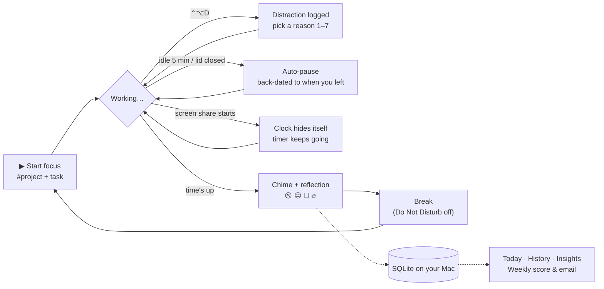
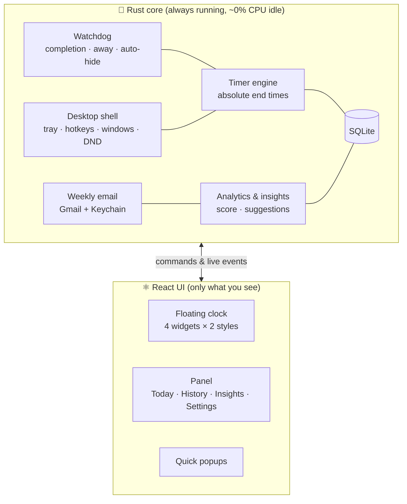

<div align="center">


# Chronos

### A little retro-futuristic clock that lives on your desktop, helps you focus, gets out of the way when you need it to, and quietly learns how you work.


[**Features**](#-what-it-does) · [**Widgets**](#%EF%B8%8F-pick-your-clock) · [**Insights**](#-is-my-focus-getting-better) · [**Shortcuts**](#%EF%B8%8F-keyboard-shortcuts) · [**Install**](#-install) · [**How it's built**](#%EF%B8%8F-how-its-built)

</div>

---

## 💡 Why Chronos?

Most Pomodoro apps are either a bare countdown or yet another dashboard fighting for your attention. Chronos is different:

> **The productivity app should never become another distraction.**

- 🕰️ **It's an object, not an app.** A small desk clock with a glowing 7-segment display, a ticking dial and real buttons. It sits on top of your work without shouting.
- 🫥 **It disappears when you need it to.** Press <kbd>⌘</kbd><kbd>⇧</kbd><kbd>H</kbd>, or let it hide by itself when you start screen sharing. The timer keeps running.
- 📈 **It answers one question:** *"Am I actually getting better at focusing?"* It gives you a weekly score, honest stats, and insights drawn from **your** data.
- 🔒 **Private by default.** No account, no cloud, no tracking. Everything lives in one file on your Mac.

---

## ✨ What it does

<table>
<tr>
<td width="50%" valign="top">

### ⏱️ A timer you can bend
- Focus, short and long breaks, with a long break every *N* sessions
- Modes: **Standard 25/5**, **Deep Work 50/10**, **Quick 15/5**, or your own
- Change time **without restarting**: <kbd>+5</kbd> <kbd>+10</kbd> <kbd>−5</kbd>, scroll the dial, or click the digits and type `18:42`
- Rock-solid timing: it runs on absolute end times in Rust, so sleep, hidden windows and app crashes can't make it drift

</td>
<td width="50%" valign="top">

### 🫥 Stays out of the way
- **Hide mode** from a hotkey, the menu bar or a button
- **Auto-hide** while Zoom screen sharing, the ⌘⇧5 recorder, OBS (or apps you add) are running
- Optional **invisible-to-screenshots** mode
- **Do Not Disturb** turns on during focus and off on breaks
- An optional countdown in the **menu bar**

</td>
</tr>
<tr>
<td width="50%" valign="top">

### 🧭 Honest focus data
- **Away detection:** step away for 5 minutes and the session pauses *back-dated to when you left*, so away time never counts
- **Distraction log:** <kbd>⌃</kbd><kbd>⌥</kbd><kbd>D</kbd> from any app, with an optional reason
- **Reflection** after each session: 😫 😐 🙂 🔥
- **Projects:** type `Finish resume #job-search` and see where your hours go

</td>
<td width="50%" valign="top">

### 🧠 It learns how you work
- A **weekly score out of 100** with a transparent breakdown
- **Insights** that only appear when the data backs them up
- **One suggestion at a time**, e.g. *"Ready to try 30-minute sessions?"*, applied in one click and never repeated once you say no
- A **weekly email** summary (opt-in, through your own Gmail)

</td>
</tr>
</table>

---

## 🎛️ Pick your clock

Four sizes, two styles. Switch any time from the clock's <kbd>⋯</kbd> menu or in Settings, and drag the corner to resize.


| | Widget | What you see | Best for |
|:-:|---|---|---|
| 🟧 | **Large** | The full desk clock: dial, task, keys | The full experience |
| ▬ | **Medium** | Dial plus phase, session, task and keys | Wide screens, a side-of-display widget |
| ◼️ | **Small** | Just the dial (keys appear on hover) | A tidy corner companion |
| 💊 | **Pill** | Time, a progress line, one key | Maximum focus, minimum distraction |

> 🎨 **Retro** is warm putty plastic with an amber CRT glow. **Minimal** is flat and quiet, and follows your Mac's light or dark mode. Each phase has its own glow: **amber** for focus, **teal** for short breaks, **violet** for long breaks.

---

## 📊 Is my focus getting better?

Chronos has four tabs: **Today**, **History**, **Insights** and **Settings**.


<details>
<summary><b>🧮 How the weekly score works</b> (click to expand)</summary>

<br>

The score is out of 100 and made of six parts. Each part shows the evidence behind it, so you always know *why* it moved.

| Part | Points | Full marks when… |
|---|:-:|---|
| ⏳ Focus time | 25 | your daily average reaches your daily goal |
| 📅 Consistency | 20 | you finish a session every day |
| ✅ Finishing sessions | 20 | you complete what you start |
| 🎯 Staying on task | 15 | you log 0 distractions per focus hour (4 or more per hour = 0 points) |
| ☕ Taking breaks | 10 | you take a real break after each session |
| 🔥 Session quality | 10 | you rate your sessions "Great" |

- If a part has no data yet (say you never rate sessions), it's **left out and the rest is rescaled** to 100. Missing data is never counted as zero.
- The score is compared with **the same days of last week**, so a Thursday is never judged against a full week.
- Chronos also tells you which part moved the score most, e.g. *"Mostly from consistency (+6 pts)"*.

</details>

<details>
<summary><b>🔍 What kind of insights?</b></summary>

<br>

Every insight comes from the last four weeks of *your* sessions, and shows what it's based on. If there isn't enough data, Chronos stays quiet.

| Insight | Example | Shown only when… |
|---|---|---|
| Best start window | *"You finish 27% more of your sessions when you start between 9 AM and 12 PM."* | at least 5 sessions inside and outside the window, and a gap of 15 points or more |
| Where you give up | *"When you stop a session early, it's usually around minute 38."* | at least 4 sessions ended early |
| Distraction peak | *"Your distractions peak between 2 PM and 4 PM."* | at least 6 distractions, 30% or more of them in that window |
| Top distraction | *"YouTube is behind 45% of your distractions."* | at least 5 distractions with a reason |
| Session length trend | *"Your average session grew from 31 to 42 minutes."* | at least 5 sessions in each 2-week half, and a change of 15% or more |
| Strongest weekday | *"Tuesdays are your strongest days, averaging 2h 10m of focus."* | at least 8 active days |
| Quality vs length | *"You rate sessions of 30 minutes or less as more productive."* | at least 4 rated sessions of each kind |

</details>

<details>
<summary><b>💬 Suggestions and the companion</b></summary>

<br>

**One suggestion at a time**, with a one-click button. Once you accept or decline one, it never comes back.

- *"You've finished nearly every 25-minute session this week. Ready to try 30 minutes?"*
- *"You finish fewer 50-minute sessions than you start. Try 30-minute sessions for a while?"*
- *"Distractions are up 30% this week. Turn on Do Not Disturb during focus sessions?"*
- *"You've been skipping most of your breaks. Want breaks to start on their own?"*

**Companion lines** appear on the clock after a session ends, and **at most one every 90 minutes**:

> *"Daily goal hit: 3h. Nice work."* · *"2h 15m of focus. Take a real break."* · *"Pushing hard. A break might help."*

</details>

<details>
<summary><b>📬 The weekly email</b></summary>

<br>

Opt in under **Settings → Weekly email**. Every Monday at 9 AM (or whenever you choose), you get last week's score, your numbers vs the week before, focus per day, projects, top insights and one thing to try. **Task names are never included.**


It's sent through **your own Gmail** using an [app password](https://myaccount.google.com/apppasswords), which is stored only in the **macOS Keychain**. If your Mac is asleep at send time, the email goes out at the next chance.

</details>

### Tiny popups, never in the way


Both popups close themselves, never need an answer, and stay hidden while you're sharing your screen.

---

## 🔄 A session, end to end



---

## ⌨️ Keyboard shortcuts

| Anywhere on your Mac | |
|---|---|
| <kbd>⌘</kbd> <kbd>⇧</kbd> <kbd>H</kbd> | Hide or show the clock (the timer keeps running) |
| <kbd>⌃</kbd> <kbd>⌥</kbd> <kbd>D</kbd> | Log a distraction |

| With the clock focused | |
|---|---|
| <kbd>Space</kbd> | Start, pause or resume |
| <kbd>R</kbd> / <kbd>⇧</kbd> <kbd>R</kbd> | Reset / restart the session |
| <kbd>S</kbd> | Skip to the next phase |
| <kbd>↑</kbd> <kbd>↓</kbd> | ±1 minute (add <kbd>⇧</kbd> for ±5) |
| <kbd>Enter</kbd> | Type an exact time: `25`, `18:42`, `1h 15m` |
| <kbd>T</kbd> | Set what you're working on (add `#project`) |
| <kbd>⌘</kbd> <kbd>,</kbd> | Open Settings |
| Right-click or <kbd>⋯</kbd> | Menu: modes, widget size, style, always on top, stats |

Both global shortcuts can be changed in Settings.

---

## 📦 Install

Chronos is built from source for now. It takes about 5 minutes the first time.

```bash
# 1. Prerequisites: Node 20+, Rust, and Xcode Command Line Tools
curl --proto '=https' --tlsv1.2 -sSf https://sh.rustup.rs | sh
xcode-select --install

# 2. Build
git clone https://github.com/nikharjajoo-tech/chronos.git
cd chronos
npm install
npm run tauri build -- --bundles app

# 3. Install and launch
cp -R src-tauri/target/release/bundle/macos/Chronos.app /Applications/
open -a Chronos
```

**Then:**
- Look for the 🕰️ **alarm-clock icon in your menu bar**. The clock appears in the top-right corner.
- **Open at login** is on by default, so Chronos comes back after a restart.
- Find it any time in **Launchpad** or **Spotlight**. Opening it again brings a hidden clock back.

<details>
<summary><b>🛠️ Developing</b></summary>

<br>

```bash
npm run tauri dev   # the real app with hot reload
npm run dev         # just the UI in a browser, with a mock backend
npm test            # frontend tests (Vitest)
npm run test:rust   # Rust tests: timer, database, analytics, insights, email…
```

The browser preview takes URL parameters for any state, which makes design work quick:
`http://localhost:1420/?view=clock&widget=pill&style=minimal&phase=focus&run=running&remaining=1122`

</details>

---

## 🔒 Privacy

| | |
|---|---|
| 📁 **Where your data lives** | `~/Library/Application Support/com.chronos.desk/chronos.sqlite3`, one file you can open, back up or delete |
| ☁️ **Network access** | **None**, except the weekly email if you turn it on (sent through your own Gmail) |
| 👤 **Accounts and telemetry** | None |
| 🔑 **Passwords** | Only the optional Gmail app password, kept in the macOS Keychain |
| 🙈 **Screen-sharing safety** | Auto-hide, a hide hotkey, and capture protection |

---

## 🏗️ How it's built



| Piece | Choice | Why this over the alternatives |
|---|---|---|
| App shell | **Tauri 2** | Uses the browser engine built into macOS instead of shipping Chrome the way Electron does, so the app is about **5 MB** and uses about **30 MB of memory** |
| Brain | **Rust** | Fast, battery-friendly and hard to crash. It keeps the timer accurate even when the window is hidden. |
| Interface | **React + TypeScript** | Quick to build and change. TypeScript catches mistakes early. |
| Storage | **SQLite** | One local file, no server, good at "this week vs last week" queries |
| Styling | **Hand-written CSS** | The clock is a custom object, not a standard dashboard |
| Secrets | **macOS Keychain** | The same safe storage Safari uses for passwords |

<details>
<summary><b>📁 Project structure</b></summary>

```text
chronos/
├── src/                      # React UI
│   ├── clock/                # floating clock: layouts, dial, 7-segment digits
│   ├── panel/                # Today · History · Insights · Settings
│   ├── quick/                # distraction & reflection popups
│   └── api.ts                # the one doorway to Rust (plus a browser mock)
├── src-tauri/src/            # Rust core
│   ├── timer.rs              # pure Pomodoro state machine (no clocks, no I/O)
│   ├── engine.rs             # timer + settings + database glue
│   ├── db.rs                 # SQLite schema & migrations
│   ├── analytics.rs          # weekly / monthly aggregates, streaks
│   ├── insights.rs           # score, insights, suggestions, companion lines
│   ├── companion.rs          # watchdog, away detection, auto-hide, DND, popups
│   ├── report.rs             # weekly email: render, schedule, send
│   ├── sysmac.rs             # macOS idle time, process list, Shortcuts
│   └── shell.rs              # windows, tray, menus, global hotkeys
└── docs/DESIGN.md            # the design notes behind all of this
```

</details>

**Tested:** 61 Rust tests (timer maths, sleep and crash recovery, away pauses, analytics, score, insights, suggestions, email rendering) and 19 UI tests.

---

## 🗺️ Roadmap

- [x] Floating clock: 4 widgets × 2 styles, hide mode, always on top
- [x] Drift-proof timer with crash recovery
- [x] Away detection, auto-hide while sharing, Do Not Disturb
- [x] Distractions, reflections, projects
- [x] History, weekly score, insights, suggestions
- [x] Weekly email
- [ ] Ambient focus sounds (brown noise, rain, a soft tick)
- [ ] Save your own focus modes
- [ ] CSV export and automatic backups
- [ ] Signed release builds with auto-update
- [ ] More themes

---

<details>
<summary><b>❓ FAQ</b></summary>

<br>

**Does hiding the clock pause my session?**
No. Hiding only hides the window. The timer and tracking keep running, and the session can finish while hidden.

**My laptop slept during a session. What happens?**
The timer works from absolute end times, so it never drifts. If you were away longer than your away-detection setting, the session pauses as of the moment you left.

**Can it hide during Google Meet in Chrome?**
Calls running inside a browser can't be detected, so use <kbd>⌘</kbd><kbd>⇧</kbd><kbd>H</kbd> or turn on *Invisible in screenshots & recordings*.

**Where's the Dock icon?**
Chronos lives in the menu bar by default. Turn on *Settings → Startup → Show in Dock* if you'd like one.

**Windows or Linux?**
Not yet. The core is cross-platform, but some features (idle detection, Do Not Disturb, auto-hide) are macOS-only for now.

</details>

<div align="center">
<br>
<sub>Made with ☕ and a lot of focus sessions · Design notes in <a href="docs/DESIGN.md">docs/DESIGN.md</a></sub>
</div>
